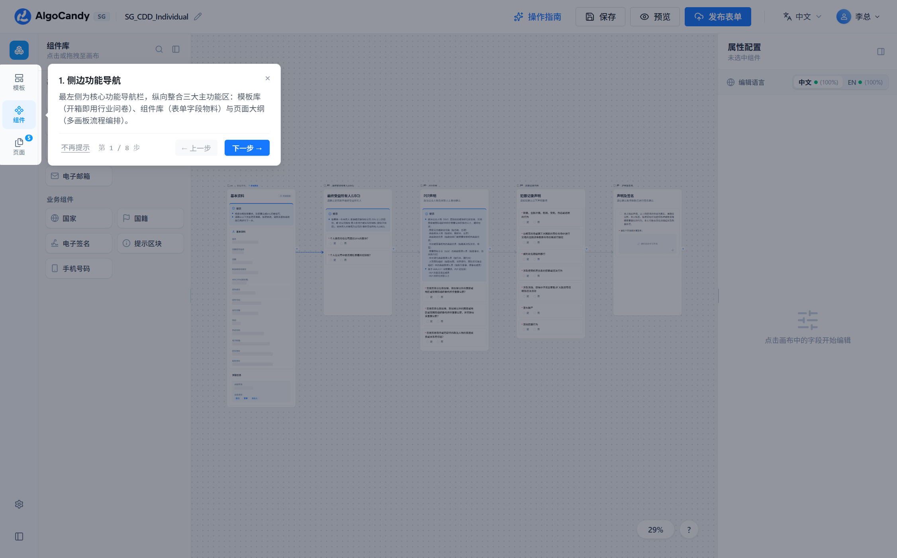
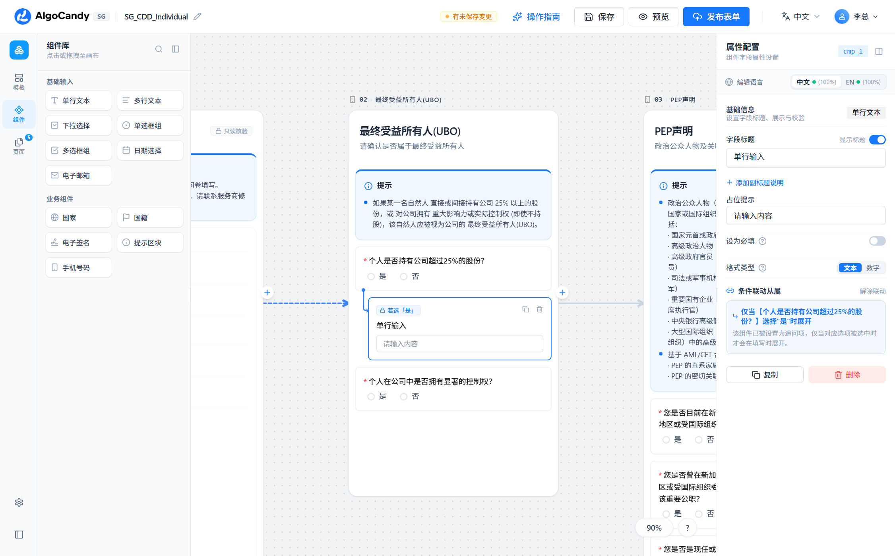
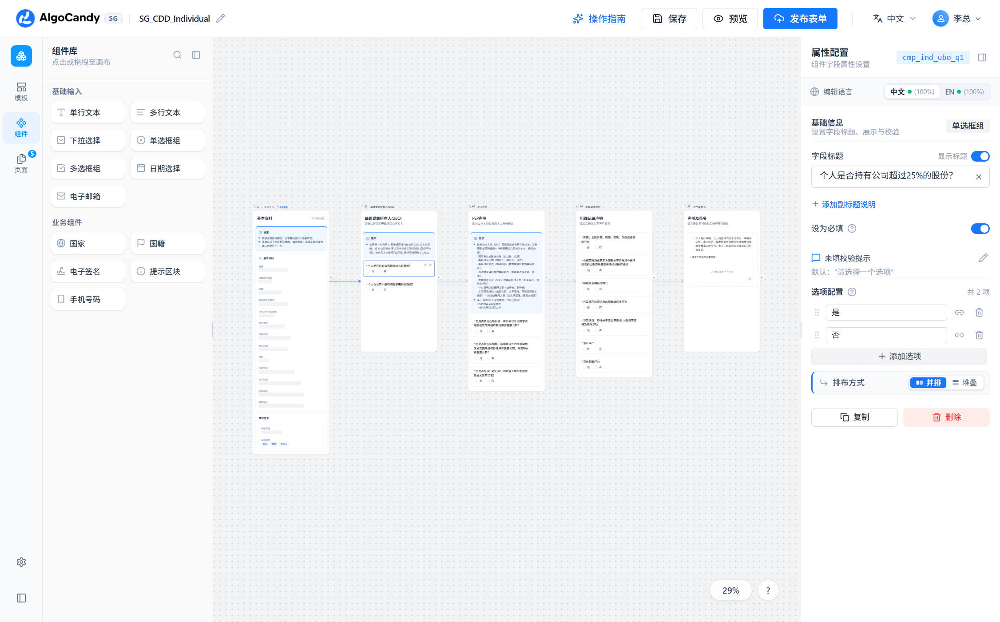
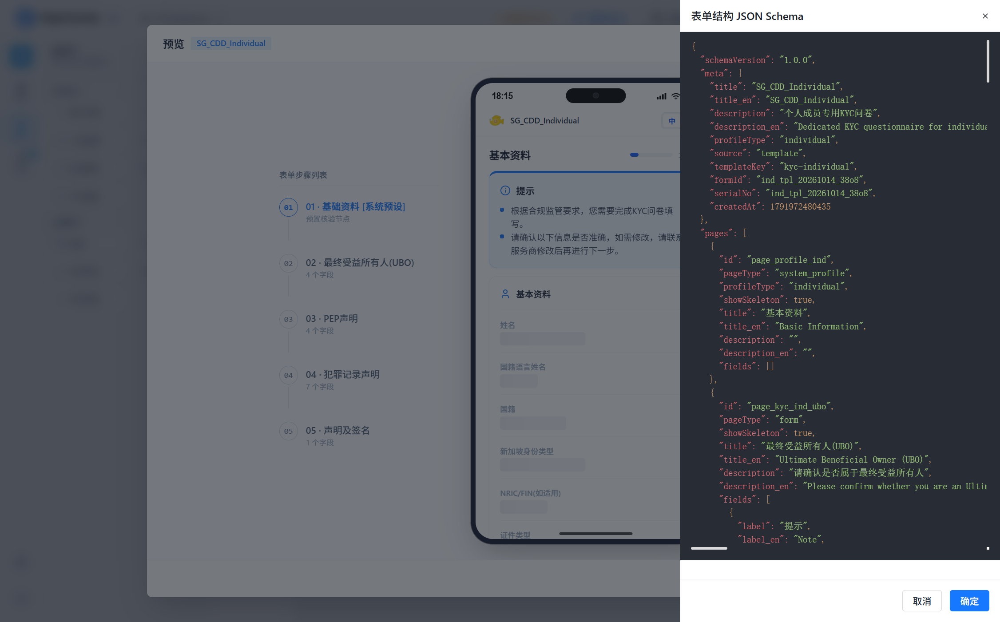

# AlgoCandy DIY 低代码表单构建器 - 官方产品功能全景与操作手册

> **文档版本**：v2.5.0 (正式发布版)  
> **适用对象**：产品经理 (PM)、业务合规分析师、交互设计师、前端/后端交付工程师  
> **系统定位**：面向跨境金融、新加坡及全球企业服务合规监管审查（KYC / CDD / AML）的**多画板无界低代码表单编排与交付平台**。

---

## 目录
1. [系统全景与工作区三栏布局](#1-系统全景与工作区三栏布局)
2. [业务主体与 URL 驱动体系 (Host & ID 规范)](#2-业务主体与-url-驱动体系-host--id-规范)
3. [场景模板库与新建向导 (Preset Scenarios)](#3-场景模板库与新建向导-preset-scenarios)
4. [无限画布视口与画板生命周期 (Multi-Page Canvas)](#4-无限画布视口与画板生命周期-multi-page-canvas)
5. [系统预设只读核验节点 (System Profile Baseline)](#5-系统预设只读核验节点-system-profile-baseline)
6. [12 大标准组件物料库全景详解 (Component Registry)](#6-12-大标准组件物料库全景详解-component-registry)
7. [树状条件联动与动态追问引擎 (Conditional Logic Engine)](#7-树状条件联动与动态追问引擎-conditional-logic-engine)
8. [多语言体系与双语完备率追踪 (i18n Architecture)](#8-多语言体系与双语完备率追踪-i18n-architecture)
9. [深度属性配置面板 (Property Panel)](#9-深度属性配置面板-property-panel)
10. [iPhone 仿真真机预览、Schema 导出与发布](#10-iphone-仿真真机预览schema-导出与发布)

---

## 1. 系统全景与工作区三栏布局

系统严格遵循现代 **B2B 专业级桌面 SaaS** 设计规范，采用「顶栏全局控制 + 左侧物料抽屉 + 中央无限画布 + 右侧属性抽屉」的四维联动布局。

### 1.1 核心布局结构与职责分工
| 区域 | 模块组件 | 职责与交互说明 |
| :--- | :--- | :--- |
| **顶部操作栏** | `AppHeader.vue` | 品牌 Logo（SG 地区标识）、表单标题就地双击/铅笔编辑、脏状态实时指示（已保存/未保存/保存中）、操作指南引导（Driver.js 漫游）、保存 (`Ctrl+S`)、预览 (`PreviewModal`)、发布 (`DeployModal`)、全局语言切换（中/英）、当前母系统登录用户（头像/姓名/机构/退出）。 |
| **左侧物料栏** | `MaterialSidebar.vue` | 采用 **260px ~ 500px 可拖拽拉伸边把手**；纵向整合 4 大功能面板：**模板库**、**组件库**、**页面大纲**、**面板布局显隐设置**。 |
| **中央设计区** | `InfiniteCanvas.vue` | 无界平移与平滑缩放画布（支持 `10% ~ 160%` 缩放）；支持多张移动端画板（390px 宽，160px 间距）从左往右流水线编排；右下角集成 Figma 风格百分比缩放胶囊菜单；底部浮现待补齐多语言翻译定位胶囊。 |
| **右侧属性栏** | `PropertyPanel.vue` | 采用 **260px ~ 520px 可拖拽拉伸边把手**；根据画布焦点实时动态切换：未选中时展示空状态，选中画板时展示页面标题/描述与页面删除，选中具体字段时展开该字段的基础信息、中英双语、校验规则、选项配置、条件从属信息。 |

---

## 2. 业务主体与 URL 驱动体系 (Host & ID 规范)

### 2.1 三类合规业务主体模式
系统以新加坡金融合规尽调（CDD / KYC）为基础领域模型，业务架构严格区隔三类主体：
1. **客户母案例 (`customer` / `client`)**：企业客户主档案，对应表单模板 `SG_CDD_Customer`，重点涵盖主营业务、年销售额、上下游国家分布、上市公司信息与法人授权声明。
2. **个人成员案例 (`individual`)**：董事、股东、授权代表个人，对应模板 `SG_CDD_Individual`，重点涵盖最终受益人 (UBO) 尽调、政治公众人物 (PEP) 声明、7 大犯罪与洗钱记录声明。
3. **机构成员案例 (`entity`)**：法人股东或关联实体，对应模板 `SG_CDD_Entity`，涵盖企业股权穿透与实体受益所有人申报。

### 2.2 规范化纯小写业务 ID 结构
表单构建器采用安全小写业务序列号，不在 URL 暴露冗长明文，格式规范为：
$$\text{formId} = [\text{业务类别}]\_[\text{创建方式}]\_[\text{年月日}]\_[\text{4位纯小写防重码}]$$

- **业务类别**：`cus`（客户）、`ind`（个人）、`ent`（机构）；
- **创建方式**：`tpl`（由预设模板生成）、`diy`（由空白画布自建）；
- **示例**：`ind_tpl_20261014_38o8`、`ent_diy_20261013_7x8k`。
- **URL 响应式绑定**：在浏览器地址栏仅常驻 `?id=ind_tpl_20261014_38o8` 参数。母系统调用中心 (`/host` 或 `CallerHostView.vue`) 可通过传递不同 ID 快速模拟草稿拉取与纯净新建流程。

---

## 3. 场景模板库与新建向导 (Preset Scenarios)

构建器左侧物料栏的 **模板库** 标签页收录了经过合规审计的标准 KYC 场景模板，支持一键载入开箱即用。

### 3.1 内建场景模板清单
| 模板名称 | 适用业务 | 画板与字段规模 | 包含关键业务板块 |
| :--- | :--- | :--- | :--- |
| **客户案例 KYC 模板** (`SG_CDD_Customer`) | 机构企业客户入驻初审 | 3 页面 · 9 字段 | 基础资料核验、公司主营业务说明、主要供应商/客户国家分布、是否上市公司（触发股票代码追问）、法定代表手写签字。 |
| **个人案例 KYC 模板** (`SG_CDD_Individual`) | 个人合伙人/董事/高管审查 | 5 页面 · 15 字段 | 个人基础信息、最终受益所有人 (UBO) 判定、政治公众人物 (PEP) 深度尽调、7 大刑事欺诈与逃税破产记录、手写合规承诺签字。 |
| **机构案例 KYC 模板** (`SG_CDD_Entity`) | 穿透持股法人企业尽调 | 3 页面 · 16 字段 | 实体基础信息、注册资本与实缴情况、UBO 股权穿透声明、反洗钱合规授权声明。 |

### 3.2 首次进入引导向导 (`WelcomeWizardModal.vue`)
当以全新空白状态（URL 无 `id`）首次打开构建器时，系统自动呼出「欢迎使用 AlgoCandy」引导弹窗：
- **方式一：新建空白画布**：选择业务主体类型后从零自建；
- **方式二：选用场景模板**：一键载入上述三大合规模板并自动生成业务 ID。

---

## 4. 无限画布视口与画板生命周期 (Multi-Page Canvas)

### 4.1 画布交互与视口控制
- **平移漫游 (Pan)**：按住 `Space + 鼠标左键拖拽` 或按住 `鼠标中键拖拽`，平移无限画布空间。
- **精准缩放 (Zoom)**：使用 `鼠标滚轮` 或点击右下角缩放胶囊，提供 `10% ~ 160%` 平滑缩放。
- **快捷预设视图**：
  - `Shift + 0`：缩放到 100% 原始尺寸；
  - `Shift + 1`：自适应全貌居中；
  - `Shift + 2`：平滑聚焦并剧中缩放到当前选中画板/组件。

### 4.2 页面大纲管理与编排
在左侧侧边栏切换至 **页面大纲** 标签页，以垂直树状列表呈现表单流转链路。

#### 页面大纲关键特性：
1. **独立紧凑序号徽章**：采用 `01, 02, 03...` 统一 20px 规格微圆角徽章，第 1 页系统预设画板配备深色锁定标识。
2. **完整标题自适应展示**：标题文字不截断，换行完整展示；当页面未输入自定义标题时，友好展示 `页面 02` 等引导占位符。
3. **锁定保护与防误删确认**：
   - 第 1 页基础资料核验页固定附带锁形图标，杜绝误删；
   - 常规页面点击删除按钮时，弹出 Arco 原生 Popconfirm 气泡核验确认（“确定删除该页面吗？”），避免数据丢失。
4. **一键添加与精准视口定位**：
   - 底部常驻虚线边框 `+ 新增空白页面` 按钮，点击即可在末尾快速追加新画板并自动将视口聚焦平移至新画板。

---

## 5. 系统预设只读核验节点 (System Profile Baseline)

所有表单流程的**第 1 画板均为系统预设节点 (`pageType === 'system_profile'`)**，这是本系统作为合规中台的核心设计。

### 5.1 业务价值与设计准则
- **数据源绑定**：填表人在外部访问表单时，系统根据账户档案或 API 传递的上下文，将企业/个人的姓名、注册号、证件号、国籍、注册地址等基础信息预先填充，供填表人核实确认。
- **画布物理约束**：
  - 第 1 画板**严格禁止添加、拖入任何表单组件**；
  - 若用户在选中第 1 画板时点击或拖拽添加物料，系统会自动寻址并插入到第 2 画板（若不存在常规表单页则自动创建第 2 页）；
  - 第 1 画板在右侧属性面板中展示为「系统预设节点 (已锁定)」，不可重命名、不可删除。

---

## 6. 12 大标准组件物料库全景详解 (Component Registry)

系统在 `src/registry/components.ts` 中注册了 12 种标准化表单物料，严格划分为基础输入组件与合规业务组件：

| 组件名称 | 标识符 (`type`) | 分类 | 特有业务属性与交互能力 |
| :--- | :--- | :--- | :--- |
| **单行文本** | `input` | 基础组件 | 支持文本 (`text`) 与纯数字 (`number`) 两种输入模式切换，支持占位符与前缀图标。 |
| **多行文本** | `textarea` | 基础组件 | 适用于详细背景陈述、业务模式说明，支持最大字数限制与多行输入。 |
| **下拉选择** | `select` | 基础组件 | 支持单选与多选模式；集成选项编辑器；**支持单选选项级触发下级条件分支**。 |
| **单选框组** | `radio` | 基础组件 | 支持横向并排 (`inline`) 与纵向堆叠 (`stack`) 胶囊切换；**支持选项级条件联动追问**。 |
| **多选框组** | `checkbox` | 基础组件 | 支持并排与堆叠布局；支持配置「最多选择 N 项」限制 (`maxSelections`)。 |
| **日期选择** | `date` | 基础组件 | 支持单个日期 (`single`) 与日期范围 (`range`)；支持年/月/日/时间；**支持「长期有效」开关**。 |
| **电子邮箱** | `email` | 基础组件 | 内建标准 Email 正则格式校验，填表时失焦自动核验邮箱合法性。 |
| **国家选择** | `country` | 业务组件 | 内置联合国 ISO-3166 全球 **244 个主权国家/地区双语名录**；支持多选与最多选择项限制；内建统一国家名录浏览弹窗 (`CountryDirectoryModal`)。 |
| **国籍选择** | `nationality` | 业务组件 | 内置全球 244 个法定国籍预设词典；支持按拼音/英文全局过滤搜索；支持多国籍录入。 |
| **手机号码** | `phone` | 业务组件 | 默认新加坡 `+65`；集成**真实国家国旗图标**与国际区号选择下拉菜单；支持严格号码规则校验 (`strictPhoneValidation`)。 |
| **提示区块** | `alert` | 业务组件 | 用于合规须知、法律警示、政策法规摘录；支持多行条例录入；不参与必填校验。 |
| **电子签名** | `signature` | 业务组件 | 集成 **HTML5 手写签名画板**；内置合规声明必须勾选条款 (`declarationRequired`)；支持一键清除重签；生成 Base64 高清笔迹。 |

---

## 7. 树状条件联动与动态追问引擎 (Conditional Logic Engine)

构建器具备高级的动态逻辑分支编排能力。当单选问题或下拉选择被选定为特定答案（如「是」）时，才会动态展开下游追问字段。

### 7.1 条件联动触发配置（选项级气泡）
1. 在右侧选中单选框组 (`radio`) 或下拉框 (`select`)。
2. 在选项编辑列表中，每个选项右侧均有一个 `Link2` 联动图标按钮。
3. 点击图标展开气泡弹窗：
   - **方式 A（一键快捷创建）**：直接点击弹窗中的组件类型（如「单行输入」或「多行文本」），系统将自动创建该组件，并将其插入到父组件的正下方，自动建立联动关系；
   - **方式 B（关联已有字段）**：勾选当前页面内已存在的下游字段，建立从属关联。

### 7.2 动态视觉树状导轨 (Tree Rails)
联动字段在画布上具有极高的辨识度：
- **缩进展示**：子组件向右内缩 24px (`!ml-6`)，形成明显的树状层级；
- **连续树状母线**：父组件底部引出蓝色母线，子组件左侧绘制平滑的 **90 度圆弧拐角与指向箭头**（若有多个子项，垂直导轨贯穿整组）；
- **条件徽标**：子组件顶部附带独立锁定徽标，如 `若选「是」`，直观指示触发条件。

### 7.3 智能级联生命周期
- **防插断插入保护**：向包含联动的父组件下方新增组件时，系统自动顺延至整组联动项底部插入，杜绝破坏树状导轨；
- **整组联动复制**：点击父组件的复制按钮，系统会自动将从属的全部子组件一同复制，并重映射唯一依赖键名；
- **级联删除清理**：删除父组件时，系统会自动级联删除所有依附于其的下级分支，杜绝产生孤儿脏数据。
- **一键解除联动**：选中从属子组件时，右侧属性面板显示「条件联动从属」蓝色卡片，点击「解除联动」即可瞬间恢复为常驻普通组件。

---

## 8. 多语言体系与双语完备率追踪 (i18n Architecture)

构建器全链路支持 **中英双语 (`zh` / `en`) 统一单源存储**。每个字段、占位符、错误提示、选项均具备独立的双语字段（例如 `label` 与 `label_en`）。

### 8.1 完备率百分比指示器
在右侧属性面板顶部，直观展示当前表单的中文与英文完备率：
- `中文 (100%)` / `EN (100%)`
- 当任一语言完备率不足 100% 时，指示圆点呈现琥珀色呼吸闪烁；
- 字段输入框右侧以橙色标签高亮提示 `待补英文` 或 `待补中文`。

### 8.2 画布底部待补齐浮动定位胶囊
当切换到目标语言且存在未翻译字段时，画布中下方自动浮现精致的悬浮胶囊：
- 展示「待补齐英文翻译 (12 项)」；
- 点击展开下拉列表，按页面层级分组陈列所有缺失字段名称与源语言文字；
- 点击「定位补齐」按钮，画布自动以平滑动画平移聚焦到对应组件，并在右侧属性输入框中触发蓝色光圈高亮提醒。

### 8.3 发布前翻译漏检拦截弹窗
在顶栏点击「发布表单」时，若系统检测到仍有字段未补齐当前语言翻译，将弹出警告拦截弹窗，列出具体缺失项，防止不合规的半吊子表单发布到生产环境。

---

## 9. 深度属性配置面板 (Property Panel)

点击画布中的任何字段，右侧属性面板将展开全面的配置表单。

### 9.1 标题与副标题自适应文本域
针对合规业务题目长、法规条款文字多的特点：
- **字段标题输入框**：采用 `<a-textarea :auto-size="{ minRows: 1, maxRows: 4 }">`，文字换行自动向下伸展，避免文字超长被遮挡；
- **字段副标题 / 补充说明**：点击「+ 添加副标题」展开，同样支持自适应高度文本域；
- **副标题排布切换**：支持微型胶囊选择器，切换「标题右侧」(`right`) 或「标题下方」(`bottom`)。

### 9.2 必填校验与个性化错误提示
- **必填开关**：一键开启或关闭；
- **错误提示自定义**：
  - 默认态以简洁文字展示系统根据字段类型和语言自动生成的提示语（如：*“默认：请选择此项”*）；
  - 点击铅笔图标即可切换为自定义输入框，支持录入针对特定合规条款的个性化报错文案；
  - 点击重置图标即可一键恢复默认。

### 9.3 选项列表编辑器 (`OptionsEditor.vue`)
- **拖拽重排**：基于 SortableJS，按住左侧手柄即可上下拖拽重新排序；
- **选项排布方式**：单选与多选支持「横向并排」与「纵向堆叠」切换；
- **回车快速新增**：在选项输入框内按下 `Enter` 键，即可直接在该行下方插入新的空选项。

---

## 10. iPhone 仿真真机预览、Schema 导出与发布

### 10.1 iPhone 16 仿真全真预览
点击顶栏「预览」按钮，即可呼出高保真移动端仿真预览弹窗。

#### 预览交互特性：
1. **真实物理机模**：精致的黑色超窄边框、灵动岛黑色胶囊、动态实时 iOS 状态栏时间、信号/Wi-Fi/电量图标。
2. **多步骤流转向导**：左侧展示表单 01 ~ 05 页面进度轴，支持自由切换页面或点击底部「下一步」校验流转。
3. **真实响应式动态联动**：在手机屏幕内点击单选框（如“欺骗或逃税行为”选“是”），从属追问输入框以流畅动画即时展开；选“否”则自动收起。
4. **必填校验阻断提示**：未填必填字段直接在机模内标红报警，提示填表人修正。
5. **手写签字与合规承诺核验**：手写画板支持平滑触控绘制与清除；必须勾选法定承诺条款后方允许最终提交。

### 10.2 低代码结构 JSON Schema 检视器
在预览界面顶栏点击「结构 JSON」按钮，右侧滑出暗色主题的代码检视抽屉。

- 实时显示当前编排的完整 `FormSchema` 结构体；
- 统计总画板数与总字段数；
- 提供一键复制 JSON 数据到剪贴板，便于前后端联调与存储入库。

### 10.3 表单发布交付与分享
在顶栏点击「发布表单」：
- 系统校验双语完备率；
- 生成该表单独一无二的终端访问 URL 与二维码；
- 交付客户即可直接在移动端浏览器或微信/企业微信中打开填表并回传数据。

---

> **文档归档信息**：本手册已同步录入项目工程代码库 `docs/PRODUCT_MANUAL.md`，配套全部真实自动化截图持久化于 `docs/images/` 目录中。如需扩充新组件或业务模板，请遵循 `src/registry/components.ts` 的规范标准进行增量注册。
